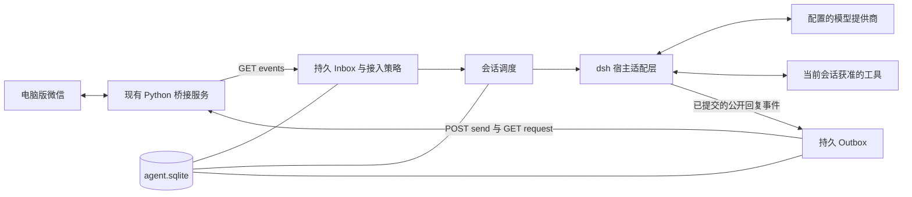

# 微信 Bot 智能体端设计

日期：2026-10-29（Asia/Shanghai）。状态：设计基线；首版实现已新增于 `agent/`，依赖已安装，构建与 32 项测试通过，官方 profile 已短时装载。实现范围、execution session 方案及剩余扩展见 [实现说明](agent/README.md)。尚未进行真实模型/微信联调及长稳验收。下文“拟新增”保留为原设计语义，不代表每项扩展都已完成。

长 session 的分层记忆见 [长会话与群聊记忆调研](AGENT_MEMORY_RESEARCH.md)，可配置提示词见 [提示词体系设计](AGENT_PROMPTS.md)。当前确定的要求：群聊无需 @ 或前缀，自主判断是否回复；每个群、每个联系人分别使用独立 session 和记忆域；支持系统、人格、场景等多类提示词及逐会话配置。

## 1. 结论与范围

建议新增 `agent/`，以 **TypeScript 编写 dsh/Cordis 微信渠道插件**，在独立的 dsh 进程中运行。现有 Python 桥接服务继续负责微信收发、媒体、原生 worker、版本校验与请求状态；智能体插件负责消息接入、会话、模型与工具配置、交互和回复调度。

首版不自己再写一套 LLM 工具循环，也不把智能体逻辑塞入 `weixin-research/`。模型调用、工具执行循环和会话日志由 dsh 承担；新增一个薄的宿主适配层，把上游接口变动限制在一个模块内。模型提供商和模型名均为配置，不因采用 dsh 就固定为某个 DeepSeek 模型。

本设计只基于本地 `AGENT_HANDOFF.md`、`README.md`、`weixin-research/BRIDGE_SERVICE.md` 及上游公开文档；没有检查本地或上游实现源码。文档中的“现有”是文档承诺，“拟新增”是设计选择，具体 SDK 方法签名须在实现前按锁定版本验证。

### 为什么选这条路线

| 路线 | 判断 |
|---|---|
| 新增 dsh 微信插件 | 推荐；复用参考项目采用的宿主能力，把开发集中在微信差异和可靠收发 |
| Python 自建完整 Agent runtime | 能做，但需要另建工具循环、历史、压缩、中断、问答和权限体系，当前收益不足 |
| 直接复制 QQ 插件替换地址 | 不采用；QQ 网关、消息更新、按钮、Markdown 和回复限制与当前微信契约不同 |

如果后续决定更换宿主，优先替换 `runtime/host-adapter.ts`；不提前实现多个引擎。

## 2. 参考项目借鉴什么

[dsh-qqbot README](https://github.com/tencent-connect/dsh-qqbot#readme) 展示了渠道插件连接 `ctx.agents`、以会话事件输出回复的结构，并提供会话路由、媒体和交互功能。本项目借鉴分层及会话映射思路；微信侧的持久接入和发送状态另行设计。

| 参考项目职责 | 微信端落点 | 处理方式 |
|---|---|---|
| 入站/出站 transport | `bridge/`、`ingress/`、`egress/` | QQ WebSocket 换成本机 HTTP 事件轮询和异步发送 |
| 会话管理、模型偏好 | `sessions/` | 持久化 session UUID，按账号、群或联系人隔离 |
| 宿主集成 | `runtime/host-adapter.ts` | 归一化输入接纳、持久事件、取消、恢复等能力 |
| 问答、操作确认 | `interactions/` | 微信用带编号的文字交互，绑定发起人和会话 |
| 媒体与文件交付 | `media/`、`tools/` | 通过桥接媒体 ID 获取内容，以受控产物 ID 发送文件 |
| 扫码绑定 | 无需移植 | 微信登录由现有桌面客户端和桥接端处理 |
| 流式消息更新、Markdown、按钮 | 首版不移植 | 当前桥接契约只承诺普通收发，没有消息编辑和交互按钮 |

上游 [0.5.4 更新记录](https://github.com/tencent-connect/dsh-qqbot/blob/main/CHANGELOG.md) 已提到宿主 API 适配；[dsh 官方说明](https://github.com/deepseek-ai/deepseek-harness#readme) 也说明其仍在开发预览阶段。因此实现时固定 dsh 与插件依赖版本及锁文件，升级后先跑适配层契约测试，不使用浮动 `latest` 部署。

## 3. 架构与进程边界



这是两个本机进程：Python bridge 与装载微信插件的 dsh。首版不再拆独立网关服务，不引入 Redis、消息队列、向量库或 Web 管理台。

| 层 | 负责 | 边界 |
|---|---|---|
| 桥接端 | 微信版本/进程、原生收发、媒体下载、事件池、发送请求状态 | 唯一直接访问微信实现的组件 |
| 微信渠道插件 | 消费游标、持久任务、路由、去重、身份策略、交互和输出 | 只使用已文档化 HTTP 契约，不导入 Python 模块 |
| dsh | 模型请求、工具循环、会话日志与恢复、能力组合 | 使用独立 profile；不继承桌面全权限 Agent 配置 |
| 模型与工具 | 根据当前输入生成回复或受限执行 | 聊天正文不能改写访问权限、目标会话和工具权限 |

插件通过正式 dsh profile/patch 装载，遵循 [dsh 官方架构文档](https://github.com/deepseek-ai/deepseek-harness/blob/master/docs/architecture.md) 的启动方式；不自行拼装一个绕过宿主启动器的 Cordis 应用。

## 4. 已有接口和对设计的约束

接口依据：[常驻桥接服务说明](weixin-research/BRIDGE_SERVICE.md)。

| 已有能力 | 智能体端使用方式 |
|---|---|
| `runs/bridge/session.json` 提供 URL/token | 路径按桥接工作目录解析，默认定位到 `weixin-research/runs/bridge/session.json`；启动和重连重新读取，不能写死端口 |
| Bearer、本机绑定和 Host 校验 | 按会话文件中的本机地址连接；令牌只进请求头，不写入模型上下文或日志 |
| `GET /health` | 分别判断接收、发送是否就绪；`blocked` 显示需人工处理，不由插件重启微信 |
| `GET /events?after=N` | 轮询读取；游标与 Inbox 在同一事务中提交 |
| SQLite 事件池，默认 7 天/5 万条 | 支持断线续读，但不是永久消息源；`truncated` 必须处理为明确缺口 |
| `POST /send/*`，`wait=false` | 持久化 Outbox 后再提交；异步查询请求状态 |
| `GET /request/{id}` | 区分本地接受、入库、服务端编号、失败与未知 |
| 文本默认最大 4096 UTF-8 字节 | 采用字节切分；不能照搬参考项目的字符数上限 |
| 媒体元数据/内容接口 | 先查状态，再下载到渠道插件自己的受控缓存 |
| `/send/emoji` | 只发送桥接端支持的收藏表情 ID；图片发送 GIF 会取首帧，不冒充动态表情发送 |

下列能力尚无足够契约，首版不得依赖：可靠的群 @ 标识、引用回复关联、消息编辑、消息撤回、联系人/群成员目录、历史/实时/重连补投的明确来源标记、多账号热切换、实际收件确认。

桥接层的观察白名单、观察前缀、轮询会话和发送白名单同时影响是否能工作。对启用自主群聊的指定群，需要桥接发布完整获准观察范围的消息，不能仍只匹配 `wxbot-` 或 `/ai `；按群白名单限制范围。智能体配置不能扩大桥接授权；实现时需提供配置对照诊断。

## 5. 建议目录

以下均为拟新增内容；现有桥接目录和证据原地保留。

```text
wechat-bot/
├── AGENT_HANDOFF.md
├── AGENT_ARCHITECTURE.md          # 本设计
├── README.md
├── weixin-research/              # 已有桥接；继续维护其原有边界
└── agent/
    ├── package.json              # dsh 插件元数据、固定依赖、构建/测试命令
    ├── pnpm-lock.yaml
    ├── tsconfig.json
    ├── cordis.patch.example.yml   # 装载微信插件及所需能力
    ├── .env.example              # 只列变量名，密钥从本机环境或凭据系统读取
    ├── .gitignore                # 排除 data、workspaces、本地配置和密钥
    ├── config/
    │   └── agent.example.yaml
    ├── presets/
    │   ├── assistant.yaml        # 首版普通聊天/媒体理解能力
    │   └── operator.yaml         # 后续显式启用的受限工作工具
    ├── prompts/
    │   ├── base.md
    │   ├── direct.md
    │   ├── group.md
    │   ├── personas/             # 可选人格模板
    │   ├── reply-decision.md     # 群聊是否发言的独立判断模板
    │   ├── styles/               # 回复风格模板
    │   └── memory/               # 提取、巩固、检索的独立提示词
    ├── src/
    │   ├── index.ts              # 插件装载、依赖声明、关闭与资源释放
    │   ├── config.ts             # 校验配置，拒绝未知键和未填身份
    │   ├── contracts.ts          # 插件内部类型，不冒充桥接新增字段
    │   ├── bridge/               # discovery、HTTP client、health、DTO 映射
    │   ├── ingress/              # poller、normalizer、policy、inbox
    │   ├── participation/        # 群内短窗口合并、回复判断、冷却和发送前复核
    │   ├── prompts/              # 模板校验、继承解析、角色组装和版本快照
    │   ├── memory/               # 当前群/联系人内的分层记忆、检索与来源回查
    │   ├── sessions/             # router、scheduler、session-map、preferences
    │   ├── runtime/
    │   │   └── host-adapter.ts   # dsh 唯一接口入口，按版本实现
    │   ├── egress/               # presenter、chunker、outbox、request-tracker
    │   ├── interactions/         # question、approval、answer-parser
    │   ├── media/                # fetch、extract、artifact-store、cleanup
    │   ├── tools/                # describe-image、transcribe、send-artifact 等
    │   ├── commands/             # new、stop、status、model 等
    │   ├── storage/              # SQLite、迁移、事务和租约
    │   └── diagnostics/          # 状态、指标和结构化日志
    ├── tests/
    │   ├── fixtures/             # 脱敏的文档形状样本和宿主事件样本
    │   ├── contracts/            # bridge DTO / dsh 适配层
    │   └── recovery/             # 崩溃、超时、重启和重复输入
    ├── data/                     # 本地运行数据，不提交
    │   ├── agent.sqlite
    │   ├── media/
    │   ├── artifacts/
    │   └── logs/
    └── workspaces/               # 按权限域隔离的工具工作目录，不提交
```

不为每个聊天对象安装一份插件。一个插件实例服务一个明确配置的微信账号；每个会话按需创建和回收 Agent。`accountKey` 使用本地逻辑别名，真实本人 wxid 置于本地配置，不写进共享文档。

## 6. 入站流程：先持久化，再运行模型

### 6.1 归一化

拟定内部消息结构：

```ts
type ChannelMessage = {
  accountKey: string;
  bridgeEpoch: string;            // 插件管理的事件源命名空间，不是桥接现有字段
  sequence: number;               // 桥接游标，只用于该事件源
  messageId: string;              // 保持字符串，禁止转换成 JS number
  conversationId: string;
  senderId: string;               // 由文档中的 sender / sender_id 显式映射
  scope: 'direct' | 'group';
  direction: 'incoming' | 'outgoing' | 'unknown';
  kind: 'text' | 'image' | 'file' | 'video' | 'voice' | 'emoji' | 'unsupported';
  text: string;
  timestampMs: number;            // 明确将桥接 timestamp 的秒转换为毫秒
  mediaRef?: string;              // 从实际元数据解析，不假设未文档化字段名
};
```

`message_id`/`server_id` 始终以字符串保存。缺少会话、发言人、可靠方向或无法识别的结构时，记录原因并跳过自动响应；不靠显示名推断身份。`@chatroom` 等会话分类规则封装于适配器，并用脱敏真实响应验证，不依正文猜群聊。

### 6.2 接收事务和背压

1. 从已提交游标读取事件页，校验响应及顺序。
2. 同一 SQLite 事务中：保存输入或明确的忽略理由，按稳定消息键去重，更新该页游标。
3. 提交后唤醒调度器。模型运行、媒体等待和回复发送都不阻塞游标提交。
4. 事务失败则保留原游标，下次重读。不能先更新游标再写消息，也不能等模型回复后才更新游标。
5. 接入积压设条数和字节上限，接近上限暂停拉取并报告本机状态；已拉取页若不能完整落盘则整页回滚，不能跳过未持久化部分。忽略记录也按期限清理。

默认每 1 秒读取一次，断线按 1/2/4/8 秒退避，封顶 30 秒并加抖动。401 时重新发现会话文件；仍失败就暂停连接。事件先到本地再排队，因此某个会话忙碌不妨碍其他会话接收。

去重键采用 `(accountKey, bridgeEpoch, messageId)`，另保留 `(bridgeEpoch, sequence)` 唯一约束。不能用正文或时间作为消息唯一键；相同正文的两条真实消息必须分别接纳。`server_id` 尚未分配时不能作为唯一依赖。

### 6.3 首次启动、停机补投和缺口

桥接首次启动跳过历史，不代表插件首次连接时事件池里没有旧消息。插件首次接入先进入“建立基线”状态，逐页读取并提交游标，但不执行模型；首次追到空页后启用自动回复。用户若要处理旧消息，后续提供显式补处理操作。

正常重启用持久化游标续读。默认对消息年龄超过 120 秒的事件只保留记录，不自动执行或补发回复；这只是抑制迟到任务的策略，不能证明消息来自实时路径。单个新鲜事件也可能是历史同步。

`truncated:true` 时先持久化缺口记录并暂停自动回复，允许继续保存现存事件。由操作者在本机选择新的基线后恢复，不能默默当作无缺口恢复，也不向群聊批量发送补偿消息。

现有文档没有 `bridge_instance_id` 或事件池 generation。插件使用本地 `bridgeEpoch`，与配置的账号/数据源绑定；更换账号、重建事件池必须显式建立新 epoch。游标倒退可用于发现一部分异常，但无法识别所有数据库替换。可靠自动识别需要未来桥接增加稳定事件源 ID；单纯重启服务不更换 epoch。

### 6.4 过滤和触发

处理顺序：结构与会话权限 → 持久化观察及记忆任务 → 交互答案/控制命令 → 新鲜度与确定性过滤 → 群内短窗口合并 → 自主回复判断 → 执行权限/速率/队列限制 → 调度。普通群消息不要求 @ 或前缀；观察与工具执行分别授权。

| 场景 | 首版行为 |
|---|---|
| 私聊 | 仅显式白名单对象；默认 `/ai ` 前缀触发，后续可逐人启用全消息触发 |
| 群聊 | 仅显式群白名单；读取获准群内上下文，自主判断发言时机，不要求 @、昵称或前缀 |
| 群 @ | 不作为发言前置条件；当前仍不依赖未验证的结构化 @ 字段 |
| 普通群消息 | 更新该群近期窗口和分层记忆；由独立回复判断决定是否调用主回复模型 |
| `outgoing` / 本人消息 | 默认不触发，防止手机同步和机器人回复回流成新任务 |
| `unknown` 方向 | 不自动处理；诊断提示配置本人身份 |
| 系统消息、未知类型 | 记录忽略，不转成普通用户指令 |
| 控制命令 | 用 `/bot ...` 命名空间；通过确定性解析，不调用模型 |

filehelper 测试若消息被标记 `outgoing`，不得删除方向过滤以便测试。可单独启用“本人测试命令”通道，仅匹配指定会话、本人 ID 和独特前缀；机器人普通回复绝不匹配该通道。首次闭环也可直接用模拟桥接验证。

### 6.5 群内自主参与

新增 `participation` 层，以“当前群的消息增量 + 有界近期窗口 + 相关群记忆 + 当前对话状态”判断 `reply / wait / silent`。发言机会包括机器人被自然语言询问、自己刚参与话题的后续、尚无人回答且能提供帮助的问题，以及该群提示词鼓励参与的话题；不要求显式点名。有人提问也不保证必须插话，需结合是否已回答、话题归属和信息增量判断。

确定性过滤先处理本人/机器人回流、重复、过期和不可处理类型；轻量模型只处理有意义的新批次，且无工具权限。判断输出包含动作、话题/回复对象、所依据的消息 ID、原因类别和源水位；这些均须校验。只有 `reply` 才调度主回复，`wait` 等新消息或有上限的短定时器，`silent` 推进已判定水位，绝不发送“无需回复”等占位文本。

短窗口默认可从静默 2 秒合并一批、连续消息最多等待 8 秒、群内发言后冷却 30 秒开始调参；单群回复频率和连续发言数设上限，可按群覆盖。相关直接追问可缩短冷却，但不跳过硬性限额。收到“先别说话/不用回答”时更新该群的参与状态；控制命令始终有独立通道。

主回复生成期间的新消息先持久化，发送前按最新水位复核：已被别人解答、话题切换、发起人取消或答案已过时则取消未提交输出或重新判断。过期回复不能因已经生成而强行发送。每批次使用稳定 decision ID，持久化其状态与水位；重启、wait 定时器及重复轮询都不能对同一批次重复插话。判断失败默认保持安静并记本机诊断，不在群里反复报错。

自主发言只授予该群当前上下文中的正常回复资格；文件访问、外部操作和工具确认继续按具体请求发言人与工具策略授权。多成员联合问题无法确定操作发起人时，仅回答信息或询问澄清，不合并成员权限。

## 7. 会话、上下文和调度

### 7.1 路由

逻辑会话键采用规范数组序列化后编码或哈希，避免直接用冒号拼接不受约束的 ID。

| 场景 | 逻辑键组成 | 回复目标 |
|---|---|---|
| 私聊 | `wechat, accountKey, direct, conversationId` | 该 conversationId |
| 每个群聊 | `wechat, accountKey, group, groupId` | 原群；该群成员的发言保留身份和顺序，在群内同一 session 中理解 |

每个群一个 session，每个联系人私聊一个 session；同一个人在群里和私聊中也使用不同 session。群 A、群 B、联系人甲、联系人乙的上下文、分层记忆、检索、缓存、任务状态、附件和产物互相隔离，不提供跨会话共享开关或全局用户画像。群内成员共用该群对话上下文，但身份、任务归属与工具权限逐人校验。

`session_map` 持久化逻辑键 → UUID session ID → generation → preset/model 偏好。`/bot new` 新增 generation，保留旧日志；先停止并结算旧任务、取消可取消输出，再切到新会话。闲置回收默认 30 分钟，只释放内存实例，不删除映射或历史；重启按原 UUID 恢复。

dsh 日志负责模型执行历史，插件库负责渠道任务，记忆层按当前群/联系人域维护派生记忆与来源索引。每次只组装有限近期原文和相关记忆，避免把全群历史重复放进 prompt；宿主需实际压缩/投影旧历史，不能只追加摘要。昵称和群消息摘要是带来源资料，不进入系统权限配置。`/bot new` 切换执行 generation；长期记忆仍只能在原群/联系人域内使用，清除记忆提供独立明确操作。

### 7.2 并发

每个逻辑会话最多一个活跃 turn，后续执行输入排队，不在运行中随意注入。不同会话首版允许最多 2 个模型任务并行；每会话最多等待 10 条，全局最多等待 100 条，另设字节上限。满队列时显式请求可按会话限频发送一次忙碌提示；普通群聊的自主发言候选只记录并重新评估新鲜度，不因队满向群里主动刷提示。

同群共享一个串行执行通道；新发言先更新观察窗口，由调度器合并为有界输入，不为每条群消息都创建回复任务。发往同一个群的消息按完整回复串行发送，避免分片交错；不同群和联系人可在全局限额内并行。`/bot stop` 和交互答案走独立控制通道，不排在普通任务末尾。

首版模型轮次超时默认 120 秒、最多 12 个工具步骤；问答/确认等待超时默认 5 分钟。达到上下文预算后在 turn 边界调用宿主压缩；长任务场景再按 preset 调整预算。

### 7.3 宿主适配层的实现前验证

`host-adapter.ts` 对外提供以下语义，以下名称是内部设计，不是声称现有 dsh SDK 方法签名：

| 内部能力 | 必须验证的语义 |
|---|---|
| `openSession` | 按持久 session ID 创建或恢复，并绑定准确的工具权限域 |
| `acceptInput` | 携带渠道 input ID，并能在宿主持久日志中查询是否接纳 |
| `readCommittedEvents` | 从持久事件恢复输出；区分公开回复、工具结果、失败尝试与内部推理 |
| `cancelTurn` | 取消当前执行，并等待明确结束边界 |
| `compactSession` | 在允许的边界压缩，保留会话身份 |
| `registerInteractions` | 将提问/操作确认绑定到正确渠道和发起人 |

插件库与 dsh 日志之间没有跨库事务。崩溃在“宿主接纳输入”和“插件记录已接纳”之间时，先按 input ID 对账。如果锁定版本无法持久关联或查询，就把任务设为 `needs_review`，不直接再次注入和执行工具。不能凭插件 Inbox 去重就声称模型和工具恰好执行一次。

同理，收到持久公开回复后先生成 Outbox；若当时崩溃，重启从宿主日志重新投影，并以 `(sessionId, generation, durableEventId, partIndex)` 去重。如果宿主输出没有稳定持久标识，必须在适配验证阶段解决或暂停恢复，不能用进程内计数代替。

## 8. 出站：持久 Outbox 和发送状态

### 8.1 从宿主事件生成微信消息

首版只发送已经提交的公开最终回复和明确交互提示；不逐 token 发消息。过滤失败尝试、取消尝试、工具原始结果、内部推理和重放日志，避免模型重试或会话恢复造成重复输出。

回复目标由原始渠道任务绑定，模型不能通过正文或工具参数改成另一个联系人/群。群内自主回复可关联一批消息；需要消歧时使用可读的发言人标签，不伪造原生 @。发送文件与正文统一在一次回复计划中去重，避免既自动交付又由发送工具重复交付。

普通文本展示：保留自然段和简单列表；表格转成逐项文本；代码保留缩进但不假设微信会渲染 Markdown。默认工具过程不刷屏，错误给出简短可行动说明。

### 8.2 分片和 request_id

每片默认最多 **3800 UTF-8 字节**，最终连同分片编号校验不超过桥接 4096 字节上限。按段落、换行、Unicode 字素边界依次切分，不能切坏中文、代理对和组合 Emoji。禁用字符在渲染后统一校验。超长回复转为受控文本产物，在配置允许时作为附件交付。

先将整个回复的固定分片、目标、内容哈希和请求 JSON 原子落入 Outbox，再开始 POST。`request_id = 'wa_' + sha256(accountKey, sessionId, generation, durableEventId, partIndex)`，取完整 64 个十六进制字符会超出 64 字符上限，因此明确截取为 60 个十六进制字符，总长 63。哈希输入用规范序列化；内容另存哈希以检测冲突。

同一个 ID 永远对应同一个请求体，包括 `wait=false`。重新渲染、修改正文、改变分片算法都不能覆盖已经落盘的请求。ID 冲突进入故障状态，不通过换 ID 绕过。

### 8.3 状态处理

| 桥接状态或故障 | 插件行为 |
|---|---|
| `prepared/queued/sending` | 持续查询，处于处理中 |
| `local_accepted` | 记录已本地接受，不重发；可以继续原回复的后续分片 |
| `message_recorded` | 记录已入本地消息库，不重发；继续跟踪 server_id |
| `server_confirmed` | 记录已有服务端编号；仍不标记对方实际收到 |
| `failed/cancelled` | 停止本回复尚未提交的后续分片，保留错误和部分发送记录 |
| `unknown` | 暂停该回复剩余分片并显示状态待核对；不生成新 ID 重发 |
| POST 网络超时 | 先用原 ID 查询；若确实不存在，允许以原 ID、原请求体重新提交 |
| 429 / 503 | 先查请求是否已存在；只有未创建请求时才按退避重试原 ID；受任务期限约束 |
| `request_id_conflict` | 停止该任务并诊断；不自动更换 ID |

桥接重启可能将队列中的请求置为 `unknown`。Outbox 的持久化保证可对账，不意味着必须自动重放每一项。请求库若被重建，旧请求查不到也不能证明从未发送；只有在原请求存储连续性已确认时自动以同 ID 重提，否则转人工核对。

`/bot stop` 取消模型和尚未提交的 Outbox；对桥接 `prepared/queued` 尝试 cancel。已经 `sending` 或被本地接受的消息不可撤回，状态中显示部分输出即可，不声称已全部取消。

首版采用“输入至少一次接入、持久业务去重、发送依赖桥接幂等、执行不确定时暂停”的语义，不承诺端到端 exactly-once 或送达。

## 9. 媒体与工具

### 9.1 媒体输入

1. 从桥接媒体引用查询元数据；`pending` 只查询和等待，不直接访问微信私有缓存或原生接口。
2. `ready` 后按允许变体读取内容，检查类型、大小并复制到 `agent/data/media/`。
3. 生成按会话绑定的内部资源 ID；模型只拿到可用资源和必要描述，不拿 Bearer、私有 CDN 密钥或任意本机路径。
4. 首版等待最多 30 秒；超时给出“媒体尚未就绪”，不猜内容。后续用户可显式重试；不在几分钟后突然补发旧回复。

| 类型 | 智能体能力与限制 |
|---|---|
| 图片 | 配置支持视觉的模型或图片描述工具；普通正文优先，不能把缩略图称为高清原图 |
| 语音 | 现有 WAV/SILK 是媒体能力；语音转文字还需另外配置 ASR，不能把收到音频等同于已识别 |
| 文件 | 按类型注册提取器，限制页数/字符/解压大小/时间；首版可先支持 txt/md，复杂格式后续接入 |
| 视频 | 后续可做有限抽帧/转写，默认不直接把完整视频送给文本模型 |
| 表情 | 可保留静态/动画资源；描述时注明采样帧，禁止声称完整理解全部动画 |

首版媒体默认单项 10 MiB、缓存总量 256 MiB、TTL 24 小时，均为插件新增限制；与桥接接收/发送上限分别校验。使用中的媒体和尚待发送的产物需引用保留，清理器不能按年龄直接删除。

### 9.2 能力预设

| preset | 允许能力 | 启用方式 |
|---|---|---|
| `assistant` | 对话、已配置的媒体理解、读取本轮已授权附件、生成自身工作区产物 | 首版默认；普通白名单用户使用 |
| `operator` | 另行配置的工作区文件/工作工具 | 后续仅授予显式 owner 或特定成员，按工具配置权限 |

首版不默认挂载任意 shell、任意路径读写和任意 HTTP 请求工具。dsh profile 中没有挂载的能力，不能仅靠提示词“禁止使用”来代替限制。`cwd` 只指定执行目录，不能当作文件访问隔离；文件和进程工具必须使用宿主实际支持的权限及隔离机制。

插件工具优先使用 `artifactId`、`mediaId`，而不是让模型传任意绝对路径或 URL。`send_artifact` 仅面向当前任务的固定收件目标；校验资源归属、规范路径、文件类型、大小与桥接 `WECHAT_BOT_MEDIA_ROOTS`。可将 `agent/data/artifacts/` 显式配置为桥接允许目录，不授权整个项目盘符。

普通聊天及当前会话已授权回复无需逐次确认。引入具有外部影响的工作工具时，为工具标注相应策略，必要时进入下面的交互确认；发送到其他聊天对象不属于普通回复能力，首版不开放。

## 10. 命令、主动提问和操作确认

命令通过本地确定性解析执行，默认只对已授权发言人有效。

| 命令 | 用途和权限 |
|---|---|
| `/bot help` | 显示当前发言人可用命令 |
| `/bot status` | 显示当前群/联系人 session 的公开状态，不泄露其他会话或受限工具细节 |
| `/bot new` | 当前群/联系人新执行会话；先结束旧任务；群内仅配置管理员可重置 |
| `/bot stop` | 按任务发起人或配置管理员判断；自主群回复可由配置管理员中断 |
| `/bot compact` | 在 turn 边界压缩当前上下文 |
| `/bot model [alias]` | 只在已配置的模型别名集合内切换，不接受任意地址或密钥 |
| `/bot preset [alias]` | 查看可用预设；升级工具权限只允许本机配置或 owner 操作 |
| `/bot persona [alias]` | 切换当前会话获准的人格模板；群内仅配置管理员可修改，不改变工具权限 |
| `/bot answer <id> <内容>` | 回答指定待答问题 |
| `/bot allow <id>` / `/bot deny <id>` | 确认或拒绝指定工具操作 |

提问示例：`问题 Q7K4：输出选 1. 简短版，还是 2. 详细版？请回复 /bot answer Q7K4 1`。答案只匹配同账号、同会话、同发起人的待答记录，不能把群内任意一个“1”当作答案。

操作确认记录绑定账号、session generation、conversationId、请求发起人、允许审批者、工具名、规范化参数摘要/哈希、到期时间和单次状态。不可预测的短 ID 只是定位符，身份校验才决定能否批准。确认展示具体动作和参数摘要；参数变化必须重新确认。

到期、拒绝、任务取消或会话重置都不能默认执行。通过原子状态转换防重复批准；宿主无法恢复挂起确认时，重启后将其失效并重新询问。待答或待确认的会话可停用普通调度，但控制消息必须仍可立即处理。

## 11. 存储与运行诊断

插件使用一个支持事务和唯一约束的 SQLite 存储，实现时选择与锁定 Node 版本兼容、可在 Windows 安装的库。不开第二套 dsh 历史库。

| 表 | 关键内容 |
|---|---|
| `source_checkpoints` | 账号/epoch、游标、建立基线状态、缺口和暂停原因 |
| `inbox` | 稳定消息键、规范消息、忽略原因、状态、租约、input correlation ID |
| `session_map` | 逻辑路由键、session UUID、generation、preset/model、活动时间 |
| `runs` | 输入与宿主 turn 的关联、运行状态、恢复/人工核对原因 |
| `participation_decisions` | 当前群、批次/源水位、reply/wait/silent、已用消息、冷却和恢复状态 |
| `prompt_snapshots` | 当前会话配置版本、模板 ID/内容哈希、每轮有效提示词快照引用 |
| `outbox` | 持久输出事件 ID、分片序号、request ID、固定请求体、状态、下次查询时间 |
| `interactions` | 提问/确认、绑定身份、参数哈希、有效期、单次完成状态 |
| `artifacts` | 资源 ID、所属权限域、路径、哈希、引用状态和过期时间 |

Inbox 可采用 `pending → dispatching → running → completed`，另有 `ignored/rejected/needs_review/failed/cancelled`。`completed` 仅表示该输入对应宿主执行结算，回复状态由 Outbox 独立表达。崩溃后过期租约必须先与宿主对账，不能直接重置为 pending。

一个账号/epoch 只允许一个活跃消费者，用单实例锁和库内租约防止误开两个插件争抢；默认使用单机实例，不做多机 HA。

运行状态区分：`starting`、`baselining`、`running`、`degraded`、`paused_gap`、`blocked`、`stopping`。接收可用而发送不可用时允许有界接入，但不开始新的模型任务，避免持续消耗模型并堆积答案；已运行任务允许在限额内结算并保留输出。

本机诊断记录接入滞后、游标缺口、重复量、排队数、活跃任务、模型耗时、待答量、媒体失败、发送 unknown/failed、Outbox 积压。默认日志只含内部关联 ID、脱敏目标和错误类别，不保存令牌或完整聊天正文；需要重放的最小输入保存在受限本地存储中，默认保留 7 天，dsh 会话历史另行明确保留策略。

正常退出顺序：停止拉新事件 → 停接新模型任务 → 取消/结算活跃任务 → 尝试取消桥接中尚可取消的请求 → 保存所有状态 → 释放适配器和数据库。重启不绕过 `unknown` 或 `needs_review`。

## 12. 配置示意

以下是拟新增的插件配置，不是现在可执行的桥接 JSON 或最终 dsh Schema。所有策略默认收紧；示例占位值必须在本地替换，密钥不写进这个文件。

```yaml
account:
  key: personal-wechat
  selfId: REPLACE_LOCALLY
bridge:
  sessionFile: ../weixin-research/runs/bridge/session.json
  pollMs: 1000
ingress:
  firstStart: baseline
  maxMessageAgeSeconds: 120
  onGap: pause
access:
  owners: []
  direct:
    mode: allowlist
    allow: []
    trigger: prefix
  group:
    mode: allowlist
    allow: []
    memberMode: all_in_allowed_group
    sessionScope: group
    trigger: autonomous
  prefix: '/ai '
participation:
  debounceMs: 2000
  maxBatchWaitMs: 8000
  cooldownSeconds: 30
  decisionContextTokens: 2000
sessions:
  isolation: conversation
  crossSessionMemory: false
prompts:
  system: prompts/base.md
  persona: prompts/personas/default.md
  groupScene: prompts/group.md
  directScene: prompts/direct.md
  replyDecision: prompts/reply-decision.md
  responseStyle: prompts/styles/default.md
  participation: prompts/participation/helpful.md
  toolBehavior: prompts/tools/default.md
  memoryExtract: prompts/memory/extract.md
  memoryConsolidate: prompts/memory/consolidate.md
  sessionCompact: prompts/compact/default.md
runtime:
  engine: dsh
  provider: REPLACE_WITH_CONFIGURED_PROVIDER
  model: REPLACE_WITH_CONFIGURED_MODEL
  preset: assistant
  maxConcurrentRuns: 2
  perSessionQueue: 10
  globalQueue: 100
  turnTimeoutSeconds: 120
  maxToolSteps: 12
  idleEvictMinutes: 30
egress:
  streaming: false
  chunkBytes: 3800
  maxInlineParts: 6
media:
  enabled: false
  maxInputMiB: 10
  cacheMiB: 256
  ttlHours: 24
interactions:
  timeoutSeconds: 300
```

群内自主判断回复和按群/联系人隔离是当前默认设计；示例中的空白名单仍须填入实际允许对象。`memberMode` 只允许群内普通观察/对话，工具权限仍逐人配置。私聊保留示例前缀方式，可逐联系人配置为全消息对话。媒体上云理解与 operator 工具需另行明确启用。provider/model 别名在宿主模型配置中解析，不由微信用户提供 URL。提示词继承、逐会话覆盖和版本规则见 `AGENT_PROMPTS.md`。

首次运行在本机检查：账号标识已填、会话文件存在、/health 可用、收发策略覆盖目标、方向可判定、API 形状可识别、媒体目录相容、宿主依赖锁定。仅做诊断时不能顺带发送测试消息。

## 13. 实施顺序与验收

### A0：适配验证，先消除宿主不确定性

新增 `agent/` 最小插件，在模拟桥接下验证：固定 dsh 版本的会话创建/恢复、input ID 对账、公开回复持久事件投影、取消和最小工具集。确定 Windows Node/SQLite 组合；提交版本锁定和能力支持矩阵。

**退出条件：** 重启能恢复同一 session；能区分已接纳与未接纳输入；能重建已提交回复而不二次调用模型；无法证明的崩溃窗口能进入 needs_review。此阶段不连接真实微信、不发送消息。

### A1：文本闭环

实现 bridge client、持久 Inbox/Outbox、群内自主回复判断、按群/联系人 session 隔离、有限近期窗口和记忆检索、可配置提示词、纯文本渲染，以及 `/bot help|status|new|stop`。工具集保持最小化，默认无模型流式发送。

**验收：** 重复轮询只执行一次；本人回流和 unknown 方向不触发；中文/Emoji 分片均不超过 4096 字节；模型超时可中断；POST 响应丢失仍使用原 ID 对账；unknown 不重发。

**自主参与及隔离验收：** 无 @、无前缀也能按上下文参与；已被回答、无需帮助和要求安静时保持沉默；连续短消息合并、生成期间被解答则撤销未提交回复、重启不重复插话。同群两名成员的关联问题进入同一 session；同一人在不同群和私聊均无跨域记忆。更换人格可影响表达，不改变权限；提示词更新按 turn 边界生效。

### A2：恢复与多会话

补齐断线退避、缺口暂停、首次基线、过期输入抑制、队列/字节上限、群出站串行、输出重投影、`compact/model` 和本机诊断。

**验收：** 在写入游标前后、宿主接纳前后、Outbox 写入前后、POST 前后分别模拟崩溃；无静默丢输入、无自动重复工具执行、无重发未知发送；两个群和一个私聊并行无串历史或串目标。

### A3：媒体、产物和交互

接入媒体状态读取、图片理解、语音转写、有限文件提取、产物发送，以及问答和工具操作确认。按功能实际配置模型/服务。

**验收：** pending 不被误读、过期资源可解释、越权资源拒绝、媒体大小有界；非发起人不能回答/批准；同一确认只能执行一次；重启确认不会变成默认允许。

### A4：按需扩展

在已纳入的群内自主参与和会话内分层记忆基础上，再考虑 operator 工具、外部知识检索、任务提醒和管理页面。提醒若引入定时主动消息，需单独定义目标授权、持久调度、期限和去重；当前自主群回复不等于已配置定时提醒。

实机联调仅使用用户指定目标与范围，不自行选择联系人或群，不借本设计运行长稳测试。已有桥接仍只具备短时验收证据；新增智能体端也不能据此宣称 7×24 稳定。常驻服务下外部联系人/群的回归应单独记录，不沿用旧短时发送服务的验证结论。

## 14. 桥接后续增强，和首版依赖分开

| 增强项 | 首版替代方案 | 何时需要 |
|---|---|---|
| 稳定事件源 ID、账号 ID、事件池 generation | 显式账号配置、本地 epoch、重建数据源手工重新基线 | 自动识别换账号/事件池替换前 |
| 公开能力与限制清单 | 按现有文档配置 4096B 等限制，不猜额外字段 | 多版本兼容与自动诊断 |
| 可靠 mention、reply-to、来源类型 | 群内上下文自主判断、无原生引用、年龄过滤与基线 | 更准确的回复关系、引用媒体和严格历史分类；群内发言不依赖 @ |
| 策略公开视图 | 对照本地配置/文档诊断 | 自动核对观察与发送白名单 |
| 发送请求库 generation / 连续性标识 | 保守暂停可疑恢复，不假定“查不到即未发送” | 请求库重建后的自动恢复 |

这些字段是建议新增的协议能力，当前客户端不能假装已存在。可以先完成 A0/A1，再按实际需求小步补契约。
