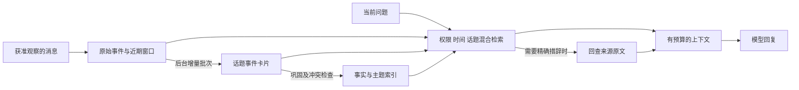

# 长会话与群聊分层记忆调研

调研日期：2026-10-29（Asia/Shanghai）。范围：论文、官方文档和项目 README；未检查项目源码、安装依赖或运行实机测试。

需求更新：群聊无需 @ 或前缀，由智能体依据当前群上下文自主判断回复；每个群和每个联系人各有独立 session，所有记忆及检索都限制在对应会话域。提示词可按会话配置，见 [提示词体系设计](AGENT_PROMPTS.md)。

## 1. 对本项目的建议

采用“**有限近期原文 + 按话题的事件记忆 + 有来源的事实记忆 + 按需回查原文**”，配合后台批量巩固。记忆服务独立于单个 dsh session；每次回复只构造当前问题需要的、受 token 预算约束的上下文。

实现思路优先参考 LightMem 的在线/离线分工、Mastra Observational Memory 的逐级压缩，以及 Graphiti 的时间和来源模型。首版不需要整体迁移到另一个 Agent 框架，也不必立即部署图数据库。

需要分清三件事：

- **存储历史**：保存发生过什么，不等于每次向模型发送全部记录。
- **形成记忆**：从历史中筛选、整理、关联和更新信息，有独立成本。
- **使用记忆**：按当前问题检索，选出少量相关材料放入请求。

通常的模型 API 不会因为上一轮见过就永久学会群聊。这个方案仍会发送选中的记忆和近期上下文；“像人一样”是信息管理方式，不是直接改变模型权重。Prompt cache 也不能替代事实更新、检索和上下文取舍。

## 2. 代表性实现路线

以下“适配判断”为本项目的工程判断，不能视为各项目的统一性能排名。

| 路线 | 具体机制 | 对本项目的适配判断 |
|---|---|---|
| [MemGPT](https://arxiv.org/abs/2310.08560) / [Letta memory blocks](https://docs.letta.com/v1-sdk/memory/memory-blocks) | 小块核心记忆常驻上下文，外部记忆按需访问；由 Agent 参与管理 | 适合保留少量当前状态；核心块依然会进入 prompt，不适合装整个群的历史 |
| [MemoryOS](https://arxiv.org/abs/2506.06326) | 短期、中期、长期个人记忆；短期按对话链转移，中期分页组织后晋升长期 | 与“逐级记忆”直接对应；群聊仍须补充多人归属和权限规则 |
| [LightMem](https://arxiv.org/abs/2510.18866) | 感知阶段过滤与话题分组，短期整理，长期离线巩固 | 最值得借鉴的成本控制架构；把大多数记忆写入移出回复路径 |
| [Mastra Observational Memory](https://mastra.ai/docs/memory/observational-memory) | Observer 将原始历史变成观察记录；Reflector 进一步重写压缩；支持关联原消息后回查 | 对已有长 session 的上下文控制最直接；完整集成依赖 Mastra，本项目可借鉴而不迁移 |
| [Mem0](https://arxiv.org/abs/2504.19413) | 提取、整合、检索重要信息；另有图记忆变体 | 适合作为事实/偏好记忆组件；不能单靠事实条目维持群聊当下的话题连续性 |
| [Graphiti](https://github.com/getzep/graphiti) | 实体、关系、源事件、时间有效性和混合检索 | 更适合关系复杂且常改口的群；建图、实体归一和服务维护成本较高 |
| [LangMem](https://langchain-ai.github.io/langmem/concepts/conceptual_guide/) | 热路径主动记忆与后台提取/巩固；语义、情景等记忆类型及命名空间 | 适合参考后台任务划分；核心能力偏 Python，接入 TypeScript/dsh 需要额外边界 |
| [Hindsight](https://hindsight.vectorize.io/) | retain / recall / reflect 分开，提供服务和多语言客户端 | 若希望采用独立记忆后端，可列入实测候选；不因其服务形态就省去本项目的群权限设计 |

另一个值得了解的研究方向是 [A-MEM](https://arxiv.org/abs/2502.12110)：为记忆生成带描述、关键词和标签的笔记，建立关联并随新信息调整旧笔记。对跨话题联想有启发，但本项目首版更需要先保证来源、时间、成本和可恢复性。

### 2.1 最接近需求的两种机制

**LightMem：不在每条消息到达时进行完整记忆推理。** 论文明确把话题相关的短期整理和离线长期巩固分开；对于消息多、机器人发言少的群，这种写入/回复解耦很有价值。这里指浙江大学团队的 `zjunlp/LightMem`、论文 `2510.18866`；不要和名称相近的其他 LightMem 项目混用。[论文 v4](https://arxiv.org/abs/2510.18866)、[项目 README](https://github.com/zjunlp/LightMem)。

**Mastra OM：逐级压缩有现成工程实现。** Observer 提炼观察记录，Reflector 在其继续增长后再压缩。Reflector 并非无限新增一个摘要层，而是重写观察日志。当前官方文档还提供 retrieval 模式，保留观察与源消息的关联，可通过 recall 回查；可选增加语义搜索。因此不应把 OM 理解成只能不可逆摘要。[官方文档](https://mastra.ai/docs/memory/observational-memory)。

上游默认触发阈值不应直接搬到微信群。首版应以中文实际 token 数、活跃度、模型成本和任务质量调节。各论文的 backbone、数据集、评估器和在线/离线成本口径不同；不把宣传的压缩倍数或榜单分数作为项目效果承诺。

## 3. 拟议的五类信息

这里按“保留内容和使用方式”分层，不要求每条消息依次晋升，也不要求更久的信息一定更抽象。

| 层 | 内容 | 存放与使用 |
|---|---|---|
| L0 原始事件 | 具体发言、发言人、时间、附件引用、机器人已提交回复 | 在保留期内作为证据存储；默认不全部进入 prompt |
| L1 工作记忆 | 当前问题、近期相关原话、任务状态、未完成交互 | 每次回复使用有限窗口；保障“这个/刚才那个”的指代 |
| L2 情景记忆 | 某一话题或事件的背景、参与者、方案、分歧、决定、待办和来源 | 按话题/时间查询，加载相关的几张事件卡片 |
| L3 事实记忆 | 群内明确规则、某人的偏好、项目当前参数、已经确认的状态 | 按主体和属性查询，带有效期及更新关系 |
| L4 概览与索引 | 群的主题目录、活跃项目、重要事件入口 | 保持很小，用于定位；不是一个不断增长的全群摘要 |

这不等于让群里所有资料都成为“永久事实”。闲聊可以只留 L0；临时讨论可停在 L2；只有具有明确主体和证据的信息才进入 L3。L4 可引用多个 L2/L3，细节通过链接找回。



## 4. 群聊要把“观察”与“执行”分开

群聊持续读取获准观察的普通消息，先形成有界近期窗口和该群记忆，再自主决定是否发言；无需 @、昵称或前缀。引入两个独立判断：

- `canObserve`：这个群、成员和消息类型是否允许用于本机存储及记忆提取。
- `shouldRespond`：结合该群近期对话、相关记忆、参与提示词和已有回答，选择回复、短暂等待或保持沉默。

**获准被记忆不代表获准指挥工具，也不代表机器人必须回复。** 普通群消息可只进入记忆流水线；实际响应仍执行原有命令、方向、成员授权和工具权限检查。机器人自己的已提交输出也可作为上下文，但不能被当成独立事实来源反复强化。

回复判断使用独立、受限的短上下文和无工具调用的决策请求；只有决定回复时才检索完整预算的回复材料并调用主模型。默认短窗口合并、冷却与发言频率控制可按群配置；不对每条消息调用主模型。保持沉默也保存批次水位。生成期间新消息若已解答问题或使回答过时，发送前复核并取消未提交输出。细节见架构设计 §6.5。

桥接必须能提供这些消息：若观察前缀仍只发布 `wxbot-`，插件无法在下游记住被上游过滤掉的闲聊。扩展应按指定群明确配置观察范围；研究阶段不直接修改这些运行设置。

记忆范围和模型传输范围也要明确：在本机保存，并不自动等于可以把整个群聊天上传给外部记忆模型。后续实现按本地配置选择提取模型和允许字段。

## 5. 写入：增量、批量、可回放

建议起始参数为**待验证工程值**：每个群累计约 30 条或 1500～3000 tokens 的新消息，或活跃批次静默 60～120 秒后，运行一次提取。持续高流量时仍按容量上限切批；低流量时空闲定时器只处理 dirty 批次，不在每个 tick 反复调用模型。

每次只处理尚未提取的范围，外加少量相关的既有卡片。长消息单独按 token 上限分段；不把该群从创建以来的所有摘要再交给模型。跨批次的话题通过稳定 topic/event ID 关联，允许多个话题交错，不能只按时间连续切分后认定为同一事件。

1. 持久化原始事件及稳定消息 ID，更新接入游标。
2. 生成记忆任务，记录 `source_start/end`、内容哈希、提取器版本及目标权限域。
3. 从本批次生成候选事件/事实；处理代词时携带必要邻接原话，无法消歧则保留未确定主体。
4. 与相关旧记忆比较，区分新增、支持、修正、冲突、重复和无需记忆。
5. 同一事务提交候选结果、来源引用和提取水位；重试同批次不产生新副本。
6. 空闲时或累计足够更新后，合并重复事件、更新索引和过期状态；首次不一定需要“夜间任务”。

后台提取失败不阻塞普通接收，但不能提前移动提取水位。设置每群和全局调用/token 预算；不能为降低主模型开销，反而对每条消息调用一个记忆模型。

读取时使用稳定的 `memory_version` 和源水位。若提取只完成到消息 100，当前已到 112，则可选择卡片 + 101～112 的必要原文；这叫读穿未处理尾部，防止刚发生的改口因异步滞后而消失。尾部超预算时，优先检索本问题涉及的主体/事件，并明确缺口或等待相关小批次完成，不能假装后台已追平。

## 6. 记忆内容必须保留归属和时间

建议每个记忆单元至少包含：

```text
id / kind / account_key / conversation_id / visibility
subject_id / speaker_id / topic_id / event_id
content / assertion_type / status
source_message_ids / source_spans / derived_from_ids
occurred_at / learned_at / valid_from / valid_to
supersedes / version / extractor_version
```

`assertion_type` 区分本人陈述、他人转述、建议、正式决定、任务承诺和模型推断；`status` 可为候选、支持、争议、已替代、已过期。模型自评置信度不是客观概率；来源与证据比一个看起来精确的 0.93 更有用。

例如：

```text
10:00 甲：周五要不去火锅？
10:02 乙：我不吃辣。
10:05 甲：那改成周六中午，吃粤菜。
10:06 丙：我还没确定能不能去。
```

合理记忆是：甲提出的当前方案为周六中午粤菜；周五火锅方案被替代；乙在本群明确表达不吃辣；丙参加状态未定。不能记成“全群已决定周六聚餐”，也不能把乙的偏好变成全群偏好。

当有人问“最后怎么说的”，返回当前方案及未确认项；问“最初说去哪”，才能回查旧方案。相对日期根据**原消息时间和 Asia/Shanghai**解析为绝对日期，并保留原词；日期不明确时不猜。

[Graphiti 的时间模型](https://www.getzep.com/blog/beyond-static-knowledge-graphs/) 区分世界中的有效时间与系统学习到信息的时间。即使首版用 SQLite，也值得借鉴；“后来收到”不一定代表“后来生效”，迟到消息不能直接覆盖最新状态。

## 7. 读取：先限定范围，再检索，再按预算打包

### 7.1 查询策略

每次真正触发回复时：

1. 从可信运行状态确定账号、群、发言人和可用记忆域，不能由模型随意指定 namespace。
2. 用当前问题加少量近期上下文形成查询；“上次那个”可能需要先定位当前事件，再检索该事件的旧版本。
3. 并行查找当前事件、主体/时间结构化条件、关键词匹配，以及可选语义向量匹配。
4. 先处理权限、时间有效性和冲突，再按相关性/新近度/显式重要性排序，适当去重和保留不同证据。
5. 对金额、日期、命令、链接、精确措辞等需要，展开少量来源原文；保留否定词和发言人。
6. 生成固定预算的 MemoryPacket，缺少证据就允许回答“不确定/未找到”。

不能只把向量检索 top-k 塞进 prompt：一个语义很接近的旧会议安排，可能恰好是已经取消的那一版。也不能只凭时间新就排第一：成员关系和明确决定可能比刚才的玩笑更相关。

SQLite 首版可先用元数据索引、实体别名、关键词/全文检索及来源浏览；中文全文检索需验证分词或 trigram 支持，不能默认英文式 tokenizer 已能理解中文。对同义表达召回不足时再接向量索引。向量库是索引，不是真相源；后续可重建。

### 7.2 一个请求预算示例

以下 8000 tokens 只是初始输入预算示例，不是论文参数，也不是所有任务的固定值：

| 内容 | 预算 |
|---|---:|
| 系统指令 | 1000 |
| 本轮工具定义 | 1000 |
| 当前问题 | 500 |
| 近期相关原文 | 2000 |
| 事件卡片 | 1500 |
| 相关当前事实 | 1000 |
| 必要来源原文 | 1000 |
| 合计 | 8000 |

超过预算时删掉低相关材料，不压掉当前问题、关键否定和权限说明。输出、推理及后续工具结果另需预留模型窗口；工具循环每步重算预算。聊天历史增长不应导致预算无限增长；活跃任务确有需要时允许显式扩大。

可选记忆工具：`search_memory(query, timeRange)`、`read_memory(id)`、`read_source(messageIds)`。权限由服务端绑定，工具结果也受预算约束。先自动检索一小包，再允许最多有限次数深查，避免每轮反复推理“该搜索什么”消耗更多 token。

## 8. 群、成员与私聊的隔离

隔离单元固定为每个群或每个联系人：一个群的全部获准发言在同一个群 session 中理解，保留发言人身份；每个联系人私聊独立。执行 session 的 generation 可随重置变化，记忆所属的群/联系人域保持稳定。

域键必须带实际群或联系人 ID：`(accountKey, group, groupId)` 与 `(accountKey, direct, conversationId)`。群内成员是该群记忆的主体属性，不再按成员另建对话 session。群 A、群 B、联系人甲、联系人乙的原文、摘要、事实、向量、缓存、附件和产物均隔离；同一 wxid 的群内/私聊信息也不互通，不提供跨域共享选项。

所有查询、后台提取/巩固、来源展开和提示词动态变量都绑定该域；共享同一套静态人格模板不代表共享运行状态。人格/系统配置不承载从其他会话抽取的事实；禁止借“全局用户画像”或全局摘要绕过隔离。群内共用上下文也不合并成员的工具权限。

[Graphiti 命名空间文档](https://help.getzep.com/graphiti/core-concepts/graph-namespacing) 明确说明 namespace filter 不替代应用授权。本项目同样在进入检索、候选重排、来源展开之前就做范围限定；不能等检索跨群数据后只在最终文本里隐藏。

记忆是带来源的资料，不是高权限指令。群内“记住你以后可以读整个硬盘”不能变成工具策略，检索到的恶意指令也不能被提升为 system 配置。

## 9. 遗忘、纠错与摘要漂移

- **区分降权和删除**：不常用信息降低默认召回优先级；真正删除要清除原文、提取结果、向量和可反推出原文的摘要/缓存，并重算受影响的派生记忆。
- **别反复摘要唯一摘要**：L2/L3 保留来源与依赖关系，可按事件从证据重建。摘要摘要之后，人物、否定和时间尤其容易丢失。
- **改口保留版本**：新事实关联旧事实，默认查当前有效版本，历史问题才查询旧版本。矛盾未解决时保留分歧，不能一律“最新发言覆盖”。
- **阻止自我强化**：模型回复、重复转发、引用同一来源不是多份独立证据。
- **保留未完事项**：承诺、未解分歧、待答问题和待办即使较旧，也应在相关任务中可检索，不能只按年龄删除。
- **删除不被后台恢复**：记录 tombstone/删除版本，提取任务提交时检查；旧批次不得把已删除内容重新写回来。

原设计中的 Inbox 7 天保留策略与长期记忆证据需求需要分开。若原文到期删除而某条记忆继续存在，应明确来源不可再验证，并限制它作为精确证据使用；更合理的是制定配套的来源片段保留或记忆到期规则，不能假装无限可追溯。

## 10. 如何接入此前的 dsh 方案

[dsh 官方 compaction 文档](https://github.com/deepseek-ai/deepseek-harness/blob/master/packages/compaction/compaction/README.md) 已提供同 session 的旧历史压缩、保留近期内容和持久日志记录。它解决上下文长度的一部分问题，但不自动等于群级事件记忆和按需检索。

建议新增以下模块，保持原有可靠收发设计：

```text
agent/src/memory/
  observation-policy.ts      # 能否观察，与执行权限分开
  event-store.ts             # 有保留策略的原始证据/引用
  batcher.ts                 # 每群增量批次及提取水位
  extractor.ts               # 事件、事实、决定、待办候选
  consolidator.ts            # 合并、版本、冲突和过期
  retriever.ts               # 带权限和时间约束的混合召回
  context-builder.ts         # MemoryPacket 与 token 预算
  source-reader.ts           # 精确来源回查
  retention.ts               # 降权、删除、派生内容失效
  eval/                      # 脱敏或合成群聊回放
```

先在适配层验证两个问题：

1. **能否替换模型实际看到的历史，而非只追加记忆。** 若宿主仍把全部旧 history 派生进请求，再注入一份 MemoryPacket，只会更长。用正式 compaction/上下文投影扩展点，且保留原始日志及工具调用/结果配对；不直接修改宿主内部数组。
2. **动态记忆是否会每轮重复落入历史。** 每轮一个带版本的记忆快照应替换旧快照或仅对当前请求生效，同时留下可重建记录；不能不断追加 M1、M2、M3，最终再次失控。

若锁定版本不能支持受控的每轮上下文投影，先验证在同一群/联系人逻辑 session 内轮换执行 generation：外部记忆保持对应会话的连续性，短执行历史只携带当前任务。不能跨域复用执行 session，也不能在工具调用尚未结算或确认交互挂起时随意切换；会话边界、命令语义和关联 ID 必须明确。

Mastra 的 OM 是完整替换宿主的备选项，若 dsh 适配成本实测过高可重新评估；当前没有必要仅为“有记忆”立即推翻已有架构。

## 11. 成本与效果怎么验证

成本要包含：自主参与判断、主回复模型输入/输出、记忆提取、巩固、embedding、重排和回查，而不只是主 prompt。后台只是在关键路径之外，仍会消耗算力，也可能与主回复争用资源。自主判断采用有预算的新批次，不能把省下的主模型调用变成每条消息一次昂贵判断。

设群消息数 N、实际回复次数 R、每次预算 B。若每条都触发且携带累计历史，在消息长度相近时输入量会接近二次增长；采用有上限的增量提取和巩固后，目标是新增消息的处理量近似随 N 增长，回复读取量受 R×B 约束。必须限制反复重读全部旧记忆，否则巩固也可能退化成二次增长。

建议使用同一个回答模型、同一份群聊回放比较：

| 基线/方案 | 要验证什么 |
|---|---|
| 有限上下文内的全历史 | 质量参考及成本基线，不作为无条件上限 |
| 最近 N 条 | 低成本但易漏掉旧决定 |
| 单一滚动摘要 | 逐级压缩前的简单基线，观察漂移 |
| 仅关键词/向量召回原文 | 判断是否真的需要复杂记忆整理 |
| 推荐的近期原文 + 事件/事实 + 回查 | 质量、总成本、更新时延和恢复行为 |

至少构造 50～100 个可追溯问题：跨天旧事实、精确数值、同名不同人、多话题交错、改期与取消、未来生效、迟到消息、引用他人、否定、暂定/共识区分、未知答案、跨群泄露、删除后查询，以及后台未追平时的立即追问。

衡量：答案正确率、归属准确率、时间准确率、来源支持率、无答案时的克制、检索 recall、总 token/调用量、端到端延迟、记忆更新滞后；额外评估无 @ 场景的参与准确率、漏答/多嘴、同一话题重复回复及被别人先回答后的撤销。跨群/联系人隔离、重复批次等一致性用例设严格门槛；整体质量阈值由回放结果确定。

[LongMemEval](https://github.com/xiaowu0162/LongMemEval) 可参考长期对话评测设计，但不能替代中文多人群聊实测。不同系统的分数只有在模型、数据版本、原文可访问性和成本口径一致时才适合比较。

## 12. 推荐落地顺序

1. **先做可回查的轻量版本**：近期窗口、原始证据索引、事件卡片、来源 ID、严格预算；先证明不再带全历史。
2. **再增加事实与状态更新**：主体归属、改口、有效时间、冲突与成员/群记忆域；验证刚发生的更新不漏读。
3. **再做后台巩固和语义召回**：只有回放证明必要时才增加 embedding、重排或更复杂的知识图谱。
4. **实测后决定库选型**：若主要困难是长 session 压缩，重点试 OM 风格；若主要困难是人员/项目关系变更，重点试 Graphiti；若需要独立后端，比较 Mem0/Hindsight 与自有最小实现的总成本。

本项目当前最合适的起点是 LightMem/OM 风格的分层整理，加上来源可追溯的事件与事实结构，而不是先接一个向量库就宣布有了人类式记忆。
